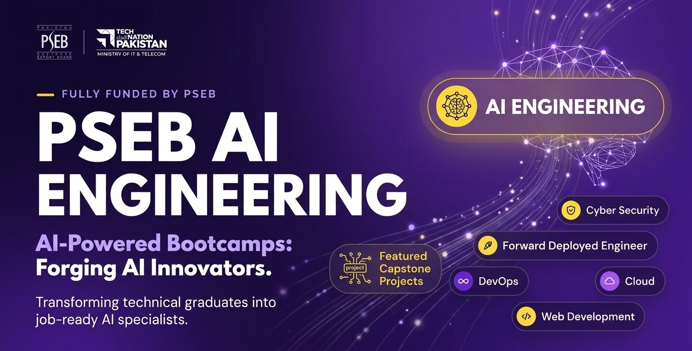

# 🚀 PSEB Tech Bootcamps – AI Engineering

  

Welcome to my repository for the **PSEB IT Bootcamp (AI Track)**! 

This 12-week intensive program, offered by the Pakistan Software Export Board (PSEB), focuses on hands-on AI Engineering—covering core Python programming, Large Language Models (LLMs), RAG-based applications, Microsoft Azure cloud integration, and industry-standard deployment workflows. 

## 🏛️ About the Program (PSEB Tech Bootcamps)

The **PSEB IT Bootcamps** program is a major national initiative funded by the **Pakistan Software Export Board (PSEB)** under the **Ministry of Information Technology & Telecommunication (MoITT)**.

Designed to bridge the gap between academic education and industry standards, the program provides high-intensity, hands-on technical training to produce job-ready tech professionals.

### 📊 Program Structure (300 Total Hours)
* 🧪 **230 Hours** — Technical Hands-on Labs & Coding
* 💬 **45 Hours** — Soft Skills, Professional Development & Team Collaboration
* 🤖 **25 Hours** — Freelancing Platforms, AI Tools & Productivity

## 🤖 Track Overview: Artificial Intelligence

The **Artificial Intelligence Track** is a full-time, 12-week bootcamp focused on core Python programming, machine learning engineering, deep learning, Generative AI, Large Language Models (LLMs), and autonomous AI agents.

* **Duration:** 12 Weeks (Full-Time)
* **Format:** In-Person Hands-on Labs & Projects
* **Target Outcome:** Industry-ready AI/ML Developer & Prompt/LLM Application Engineer

## 📚 Detailed Course Curriculum

> *250-hour technical core journey — From Python foundations to building and deploying AI applications.*

<table width="100%">
  <thead>
    <tr>
      <th align="left">Module</th>
      <th align="left">Focus Area</th>
      <th align="left">Technologies & Concepts</th>
    </tr>
  </thead>
  <tbody>
    <tr>
      <td><b><a href="https://github.com/mj-awad17/AI-Engineering-bootcamp/tree/main/Week-1">01. Python & Software Engineering<a/></b></td>
      <td>Core Programming</td>
      <td>Python, OOP, Git/GitHub, APIs, SQL, and Testing</td>
    </tr>
    <tr>
      <td><b><a href="https://github.com/mj-awad17/AI-Engineering-bootcamp/tree/main/Week-2">02. Data Analysis & Engineering</a></b></td>
      <td>Data Pipelines</td>
      <td>NumPy, Pandas, Data Cleaning, and Data Pipelines</td>
    </tr>
    <tr>
      <td><b><a href="https://github.com/mj-awad17/AI-Engineering-bootcamp/tree/main/Week-3">03. Machine Learning</a></b></td>
      <td>ML Algorithms</td>
      <td>Regression, Classification, Clustering, and Model Evaluation</td>
    </tr>
    <tr>
      <td><b>04. Deep Learning</b></td>
      <td>Neural Architectures</td>
      <td>Neural Networks, PyTorch, CNNs, and Transformers</td>
    </tr>
    <tr>
      <td><b>05. Azure AI Fundamentals (AI-103)</b></td>
      <td>Cloud Certification</td>
      <td>AI Concepts, Responsible AI, Azure AI Foundry, and Exam Prep</td>
    </tr>
    <tr>
      <td><b>06. Generative AI, RAG & Agents</b></td>
      <td>Applied GenAI</td>
      <td>LLMs, Prompt Engineering, Retrieval (RAG), Embeddings, and AI Agents</td>
    </tr>
    <tr>
      <td><b>07. AI Backend, MLOps & Azure</b></td>
      <td>Production Deployment</td>
      <td>FastAPI, Model Monitoring, CI/CD, and Azure Cloud Deployment</td>
    </tr>
    <tr>
      <td><b>08. Capstone & Career Readiness</b></td>
      <td>Project & Portfolio</td>
      <td>Industry Project, GitHub Portfolio Optimization, and Mock Interviews</td>
    </tr>
  </tbody>
</table>

## 🎯 Program Goals & Requirements

- [ ] Complete 230+ hours of technical practical labs
- [ ] Maintain $\ge 80\%$ attendance requirement
- [ ] Build and present a real-world Capstone Project
- [ ] Complete soft skills & freelancing training modules

## 🌐 Official Resources

* **PSEB Portal:** [Tech Destination Pakistan](https://bootcamps.techdestination.com/)
* **Ministry:** [Ministry of IT & Telecom (MoITT)](https://moitt.gov.pk/)
