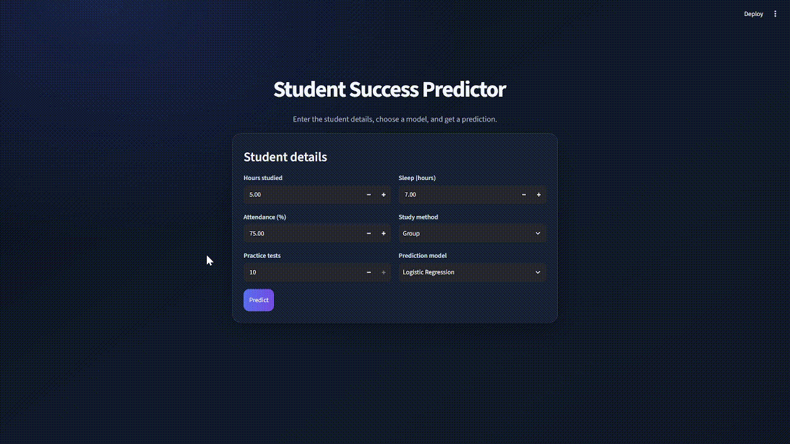
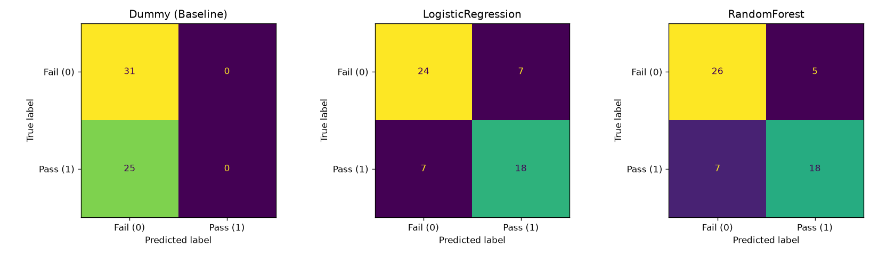

<div align="center">

# Student Success Predictor

### A small machine-learning project that predicts whether a student is likely to pass.

<a href="https://github.com/mj-awad17/AI-Engineering-bootcamp/tree/main/Week-3/Assignment/mjawad_000287">
  
</a>
<a href="https://github.com/mj-awad17/AI-Engineering-bootcamp">
  
</a>



</div>

## About

Student Success Predictor is an interactive Streamlit app built around two
trained scikit-learn classification pipelines. Enter a student's study habits,
select a model, and the app predicts **PASS** or **FAIL**. The project includes
the app, the saved models, the training notebook, sample student data, sample
prediction outputs, and a confusion-matrix visualization.

The app is intended as a learning demonstration of how a trained model can be
used in a simple interface. Its predictions are estimates based on the training
data, not guarantees about an individual student's results.

## Features

- Choose between **Logistic Regression** and **Random Forest**.
- Enter the model's five input features in a Streamlit form.
- Get a simple **PASS** or **FAIL** result.
- See a celebratory balloons animation for PASS and a snow animation for FAIL.
- Load the trained models from files in this project folder; the app does not
  retrain models when it runs.

## Model inputs

| Input | Meaning | Form range or choices |
|---|---|---|
| `hours_studied` | Hours spent studying | 0–24 |
| `attendance` | Attendance percentage | 0–100 |
| `practice_tests` | Number of practice tests | 0–10 |
| `sleep_hours` | Hours of sleep | 0–24 |
| `study_method` | Student's study method | Group, Self, or Video |

The target is `passed` (`1` = pass, `0` = fail). `final_score` appears in the
dataset, but is intentionally excluded from the model inputs because it is not
one of the features used by the trained pipelines.

## Models and preprocessing

Both saved models are scikit-learn pipelines. The preprocessing pipeline
imputes missing numerical values with the median and scales numerical features.
It imputes missing categorical values with the most frequent value and
one-hot encodes the study method. The app supplies inputs using the original
feature names expected by these pipelines.

| Model | Saved file |
|---|---|
| Logistic Regression | `Student-Log_R_model.joblib` |
| Random Forest | `Student-rf_model.joblib` |

The notebook includes a comparison against a majority-class baseline and the
confusion-matrix figure below. On the displayed held-out split, the confusion
matrix counts (true Fail/Pass rows, predicted Fail/Pass columns) are:

| Model | Confusion matrix | Accuracy on displayed split |
|---|---:|---:|
| Logistic Regression | `[[24, 7], [7, 18]]` | 75.0% |
| Random Forest | `[[26, 5], [7, 18]]` | 78.6% |

These are results from one evaluation split, not a promise of performance on
new data.

<p align="center">
  
</p>

## Run the app

Use Python 3 and install the app's runtime packages:

```powershell
python -m pip install streamlit pandas scikit-learn joblib
```

From this project folder, start Streamlit:

```powershell
streamlit run app.py
```

Streamlit prints a local URL (usually `http://localhost:8501`) to open in your
browser. Keep the two `.joblib` model files beside `app.py`; the app resolves
their paths relative to its own location.

## Project files

| File | Description |
|---|---|
| [`app.py`](app.py) | Streamlit user interface and prediction flow |
| [`student_learning.ipynb`](student_learning.ipynb) | Data exploration, model training, evaluation, and model export |
| [`student_learning.csv`](student_learning.csv) | Student training dataset |
| [`new_student_learning.csv`](new_student_learning.csv) | Example student records for prediction |
| [`Student-Log_R_model.joblib`](Student-Log_R_model.joblib) | Saved Logistic Regression pipeline |
| [`Student-rf_model.joblib`](Student-rf_model.joblib) | Saved Random Forest pipeline |
| [`new_student_predictions.csv`](new_student_predictions.csv) | Example Logistic Regression prediction output |
| [`new_student_rf_predictions.csv`](new_student_rf_predictions.csv) | Example Random Forest prediction output |
| [`confusion_matrices.png`](confusion_matrices.png) | Model evaluation visualization |

## Explore and support

This project is part of the [PSEB AI Engineering Bootcamp repository](https://github.com/mj-awad17/AI-Engineering-bootcamp).
If this project was useful or interesting, please **star the repository** on
GitHub and share it with others who are learning machine learning. Your support
helps more learners discover the project!

<div align="center">
  <a href="https://github.com/mj-awad17/AI-Engineering-bootcamp">
    
  </a>
</div>
