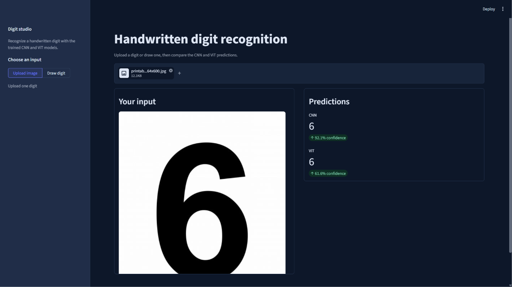
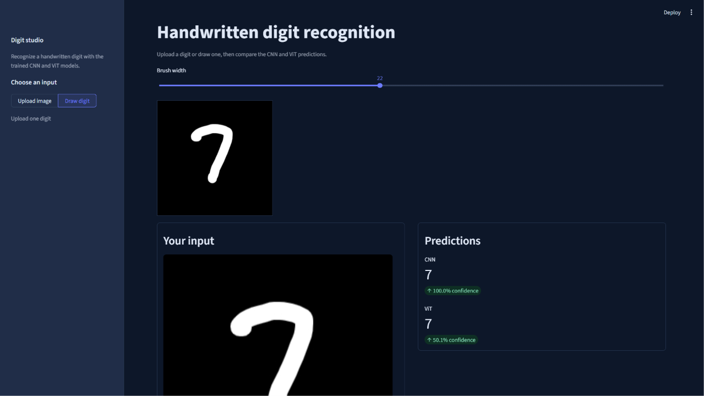
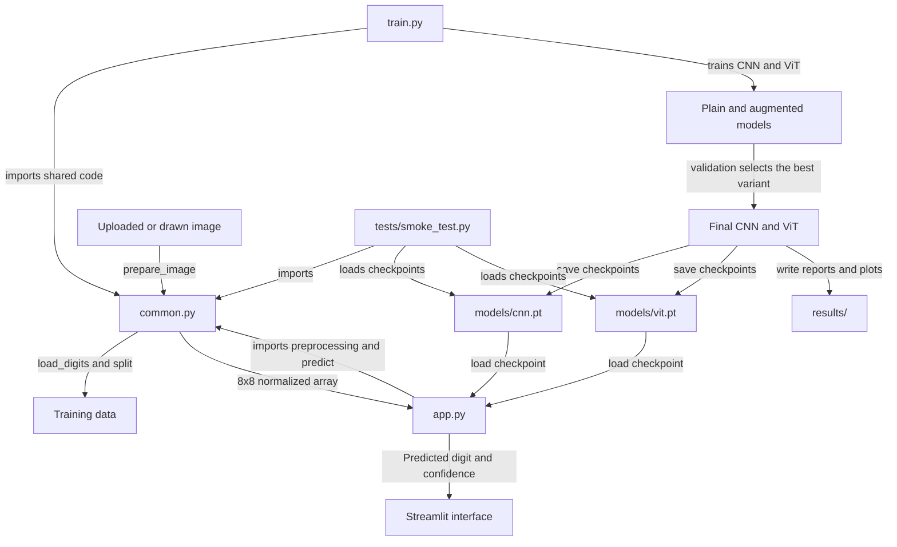

# mj.digitStudio

[](https://www.python.org/)
[](https://streamlit.io/)
[](https://pytorch.org/)
[](https://scikit-learn.org/stable/modules/generated/sklearn.datasets.load_digits.html)


**mj.digitStudio** is an interactive handwritten-digit recognition studio built with Streamlit. It lets users upload a PNG/JPEG or draw a digit on a board, preprocess the image, and compare predictions from a Convolutional Neural Network (CNN) and a Vision Transformer (ViT).


<p align="center">
  <a href="#quick-start"></a>
  <a href="#run-the-training-pipeline"></a>
  <a href="#launch-the-streamlit-app"></a>
  <a href="#project-results"></a>
</p>

---




---

## Table of contents

1. [Project overview](#project-overview)
2. [What the application does](#what-the-application-does)
3. [Directory guide](#directory-guide)
4. [How the files are connected](#how-the-files-are-connected)
5. [Architecture](#architecture)
6. [Training workflow](#training-workflow)
7. [Image-processing workflow](#image-processing-workflow)
8. [Quick start](#quick-start)
9. [Run the training pipeline](#run-the-training-pipeline)
10. [Launch the Streamlit app](#launch-the-streamlit-app)
11. [Project results](#project-results)
12. [Using the app](#using-the-app)
13. [Understanding the code](#understanding-the-code)
14. [Troubleshooting](#troubleshooting)
15. [Support the project](#support-the-project)

---

## Project overview

This project explores two approaches to image classification:

| Component | Role |
|---|---|
| CNN | Learns local visual patterns such as edges and curves using convolutional filters |
| ViT | Divides the image into patches and uses learned relationships between those patches |
| Streamlit | Provides the browser interface for uploading or drawing digits |
| PyTorch | Builds, trains, stores, and runs both neural networks |
| scikit-learn | Supplies the digit dataset, stratified splitting, and evaluation metrics |
| Pillow | Opens, validates, and preprocesses uploaded or drawn images |

The models operate on an 8 x 8 grayscale image containing values from `0` to `1`. The original scikit-learn digit images are 8 x 8, so every stage—from training to upload preprocessing—uses the same dimensions and pixel scale.

## What the application does

1. A user uploads an image or draws a digit.
2. `common.py` converts the input into an 8 x 8 normalized grayscale array.
3. The app loads `models/cnn.pt` and `models/vit.pt`.
4. `common.predict()` sends the prepared array through both models.
5. The interface displays the predicted digit and confidence for each model.
6. Blank, broken, unsupported, or unreadable images are rejected with a clear warning.

The app is an inference application only: it **does not retrain** the models. Run `train.py` whenever the training process or data changes.

---

## Directory guide

```text
mj.digitStudio/
├── app.py                    # Streamlit UI and model inference
├── common.py                 # Shared data, preprocessing, model, and checkpoint code
├── train.py                  # Training, validation, testing, and result generation
├── requirements.txt          # Python dependencies
├── README.md                 # Project documentation
├── tests/
│   └── smoke_test.py         # Basic preprocessing and prediction checks
├── models/
│   ├── cnn.pt                # Trained CNN checkpoint
│   └── vit.pt                # Trained Vision Transformer checkpoint
├── results/
│   ├── metrics.json          # Accuracy and F1 data in machine-readable format
│   ├── results.md            # Generated text report
│   ├── split_indices.json    # Shared train/validation/test indices
│   ├── confusion_matrices.png
│   ├── errors.png
│   ├── history_cnn_aug.json
│   └── history_vit_aug.json
└── .streamlit/
    └── config.toml           # Dark visual theme and sidebar settings
```

### File responsibilities

| File or folder | Start here if you want to understand... |
|---|---|
| `common.py` | Dataset loading, image preparation, CNN/ViT definitions, and prediction logic |
| `train.py` | How the models are trained, compared, selected, and saved |
| `app.py` | The Streamlit interface and the upload/draw-to-prediction flow |
| `requirements.txt` | Which libraries must be installed |
| `tests/smoke_test.py` | Whether preprocessing and both checkpoints still work |
| `models/*.pt` | The final trained parameters loaded by the application |
| `results/metrics.json` | The numerical final and variant results |
| `results/results.md` | A human-readable model comparison |
| `results/confusion_matrices.png` | CNN and ViT classification errors |
| `results/errors.png` | Sample test images the models classified incorrectly |
| `.streamlit/config.toml` | The app's page, card, sidebar, and theme colors |

---

## How the files are connected



The central shared file is `common.py`. It prevents training and inference from drifting apart because both paths use the same:

- class mapping: index `i` represents digit `i`;
- input size: 8 x 8;
- normalized scale: 0 to 1;
- model architecture;
- checkpoint loader;
- preprocessing logic.

---

## Architecture

### CNN

The CNN receives a tensor shaped `[batch, 1, 8, 8]` and passes it through:

```text
Input 1 x 8 x 8
  -> Convolution + BatchNorm + ReLU
  -> Convolution + BatchNorm + ReLU
  -> 2 x 2 pooling
  -> Fully connected layer
  -> 10-digit output
```

The convolutional layers learn local stroke patterns, while the pooling and fully connected stages combine these patterns into a digit class.

### Vision Transformer

The ViT receives the same 8 x 8 image and divides it into sixteen 2 x 2 patches:

```text
1 x 8 x 8
  -> 16 patches
  -> Linear projection
  -> Learned positional information
  -> 2 Transformer encoder layers
  -> 4 attention heads
  -> Averaged representation
  -> 10-digit output
```

The ViT learns relationships between all patches instead of primarily relying on local convolutional filters.

---

## Training workflow

The complete training process is implemented in `train.py`.

1. `load_digits()` loads 1,797 examples with labels from 0 through 9.
2. Pixel values are divided by 16 to produce values from 0 to 1.
3. `make_split()` creates one shared stratified split:
   - 70% training;
   - 15% validation;
   - 15% testing.
4. Seed `42` is used for reproducibility.
5. The exact split is written to `results/split_indices.json`.
6. A majority-class baseline is calculated.
7. Both CNN and ViT are trained with:
   - a plain dataset;
   - a controlled augmented dataset.
8. Augmentation includes rotation, shifting, scaling, blur, brightness changes, and noise.
9. Validation accuracy and perturbed validation accuracy determine the selected variant.
10. The test set is used only after variant selection for final reporting.
11. Selected checkpoints are saved to `models/cnn.pt` and `models/vit.pt`.
12. Metrics, training histories, confusion matrices, and error examples are generated in `results/`.

Validation is not used merely to retrain until the test score looks better. The test set remains held out for reporting.

---

## Image-processing workflow

Upload processing is implemented in `common.prepare_image()`:

1. Open the image safely with Pillow.
2. Accept PNG or JPEG input only.
3. Convert the image to RGB.
4. Convert it to grayscale.
5. Detect whether the background is dark or bright.
6. Invert bright-background images so the digit stroke is bright.
7. Apply contrast stretching.
8. Find the digit's bounding box.
9. Crop the digit and place it on a square canvas.
10. Resize to 8 x 8 using Lanczos resizing.
11. Scale pixel values to the 0–1 range.
12. Reject the image if it is too small or contains no meaningful stroke.

For the best upload or drawing result:

- use one digit;
- keep it large and centred;
- use a dark digit on a plain light background or a bright digit on a dark background;
- avoid multiple digits, heavy shadows, and complex backgrounds;
- use a thick stroke when drawing.

---

## Quick start

### Requirements

- Python 3.10 or newer recommended;
- Windows, macOS, or Linux;
- `pip`;
- approximately 2 GB of free disk space for the environment and packages.

### 1. Clone the repository

```bash
git clone https://github.com/<your-username>/<your-repository>.git
cd <your-repository>
```

On Windows PowerShell, use a virtual environment:

```powershell
py -m venv .venv
.venv\Scripts\Activate.ps1
python -m pip install --upgrade pip
pip install -r requirements.txt
```

On macOS or Linux:

```bash
python3 -m venv .venv
source .venv/bin/activate
python -m pip install --upgrade pip
pip install -r requirements.txt
```

> If you already have trained checkpoints, you can launch the app directly. If the `models/` folder is missing or empty, run the training pipeline first.

---

## Run the training pipeline

From the project root:

```bash
python train.py
```

Training generates or updates:

- `models/cnn.pt`
- `models/vit.pt`
- `results/split_indices.json`
- `results/metrics.json`
- `results/results.md`
- `results/history_cnn_*.json`
- `results/history_vit_*.json`
- `results/confusion_matrices.png`
- `results/errors.png`

Training time depends on CPU/GPU availability and system speed. The scripts use CPU-compatible PyTorch operations and will also run on a machine without a CUDA GPU.

---

## Launch the Streamlit app

Start the application from the project root:

```bash
streamlit run app.py
```

Streamlit normally opens the app at:

```text
http://localhost:8501
```

The browser tab title is `mj.digitStudio`, and the interface uses the dark theme in `.streamlit/config.toml`.

---

## Project results

The latest generated results are summarized below:

| Model | Variant selected | Test accuracy | Test macro F1 | Perturbed-test accuracy |
|---|---|---:|---:|---:|
| Majority baseline | — | 10.4% | 1.9% | — |
| CNN | Augmented | 99.6% | 99.6% | 94.4% |
| ViT | Augmented | 98.9% | 98.9% | 93.7% |

- [Numerical metrics](results/metrics.json)
- [Human-readable results](results/results.md)
- [Confusion matrices](results/confusion_matrices.png)
- [Test error examples](results/errors.png)

The **perturbed** test set applies fixed random shifts, rotation, blur, noise, and scale changes. It is a robustness check, not a replacement for real-world testing.

Real photographs are harder than clean sklearn digits because of stroke thickness, lighting, shadows, background, centering, and the loss of detail created by reducing the image to 8 x 8 pixels.

---

## Using the app

### Upload an image

1. Open the sidebar.
2. Select **Upload image**.
3. Choose a PNG or JPEG file.
4. Review the original image in **Your input**.
5. Read each model's digit prediction and confidence in **Predictions**.

### Draw a digit

1. Open the sidebar.
2. Select **Draw digit**.
3. Adjust the brush width if needed.
4. Draw one large digit on the board.
5. The app preprocesses and predicts as the canvas updates.

Use the canvas trash icon to clear the drawing.

---

## Understanding the code

### To modify preprocessing

Edit `prepare_image()` in `common.py`.

Keep these concepts aligned:

- image dimensions;
- grayscale conversion;
- inversion behavior;
- normalization range;
- crop and centering behavior.

Changes here affect both training uploads and smoke-test behavior.

### To change model architectures

Edit `DigitCNN` or `DigitViT` in `common.py`, then update saved checkpoints by retraining with `train.py`.

### To change training settings

Edit the `CFG` dictionary near the top of `train.py`. It contains epochs, learning rate, weight decay, and architecture configuration.

### To modify the interface

Edit `app.py`. Model and preprocessing behavior should remain in `common.py` so the UI stays simple and reusable.

### To modify colors and layout

Edit `.streamlit/config.toml`. Follow the Streamlit theme keys already provided in that file instead of adding internal CSS selectors.

### Run the smoke test

```bash
python tests/smoke_test.py
```

The test checks:

- CNN and ViT output shapes;
- blank image rejection;
- unreadable and missing-file rejection;
- prediction behavior on digit examples;
- prediction behavior on larger font-rendered digits.

---

## Troubleshooting

### `Saved models not found`

Run:

```bash
python train.py
```

Confirm that `models/cnn.pt` and `models/vit.pt` exist.

### Drawing board unavailable

Install the canvas dependency:

```bash
pip install streamlit-drawable-canvas
```

### Blank or rejected upload

Use a plain, well-lit image containing exactly one large, centred digit.

### Import or package errors

Activate the virtual environment, then reinstall dependencies:

```bash
python -m pip install --upgrade pip
pip install -r requirements.txt
```

### Port already in use

Start Streamlit on another port:

```bash
streamlit run app.py --server.port 8502
```

---

## Support the project

If this project helped you learn CNNs, Vision Transformers, image preprocessing, or Streamlit, consider giving the repository a **star** ⭐.

Stars help other learners discover the project and recognize the work behind it. You can also:

- fork the repository;
- improve the interface or preprocessing;
- add tests;
- experiment with model architectures;
- share feedback or ideas through an issue;
- submit a pull request.
