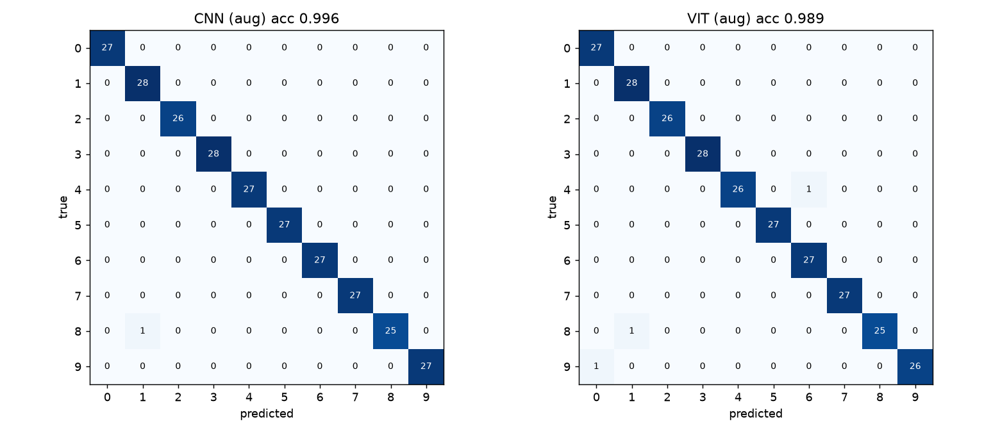
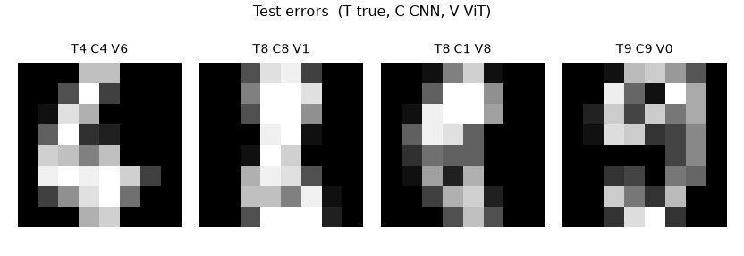

# Results

Split (stratified, shared): train 1257 / val 270 / test 270

## Test set (held out, used only for reporting)

| Model | Accuracy | Macro F1 | Perturbed-test acc |
|---|---|---|---|
| Majority baseline (always 3) | 0.104 | 0.019 | - |
| CNN (aug) | 0.996 | 0.996 | 0.944 |
| VIT (aug) | 0.989 | 0.989 | 0.937 |

## Improvement path (plain -> augmented)

| Variant | Val acc | Val perturbed | Test acc | Test perturbed |
|---|---|---|---|---|
| cnn_plain | 0.993 | 0.856 | 0.996 | 0.867 |
| cnn_aug | 0.993 | 0.959 | 0.996 | 0.944 |
| vit_plain | 0.970 | 0.781 | 0.956 | 0.730 |
| vit_aug | 0.985 | 0.944 | 0.989 | 0.937 |

Perturbed = fixed random shift/rotation/scale/blur/noise copy of the same split,
a proxy for messy real photos. Model variant chosen on VALIDATION only.

## Mistakes

- CNN most common errors: true 8 -> pred 1 (1x).
- VIT most common errors: true 9 -> pred 0 (1x), true 8 -> pred 1 (1x), true 4 -> pred 6 (1x).
- Only a handful of test errors, so no strong pattern; confusions involve digits whose 8x8 shapes look alike (e.g. 8 vs 1, 4 vs 6, 9 vs 0) because a stroke is only 1-2 pixels wide.
- Real photos are harder than sklearn digits: different stroke width, lighting, background, blur and centering; resizing a big photo to 8x8 loses detail the models never saw. Matching the 0-1 scale does not guarantee photo accuracy.

